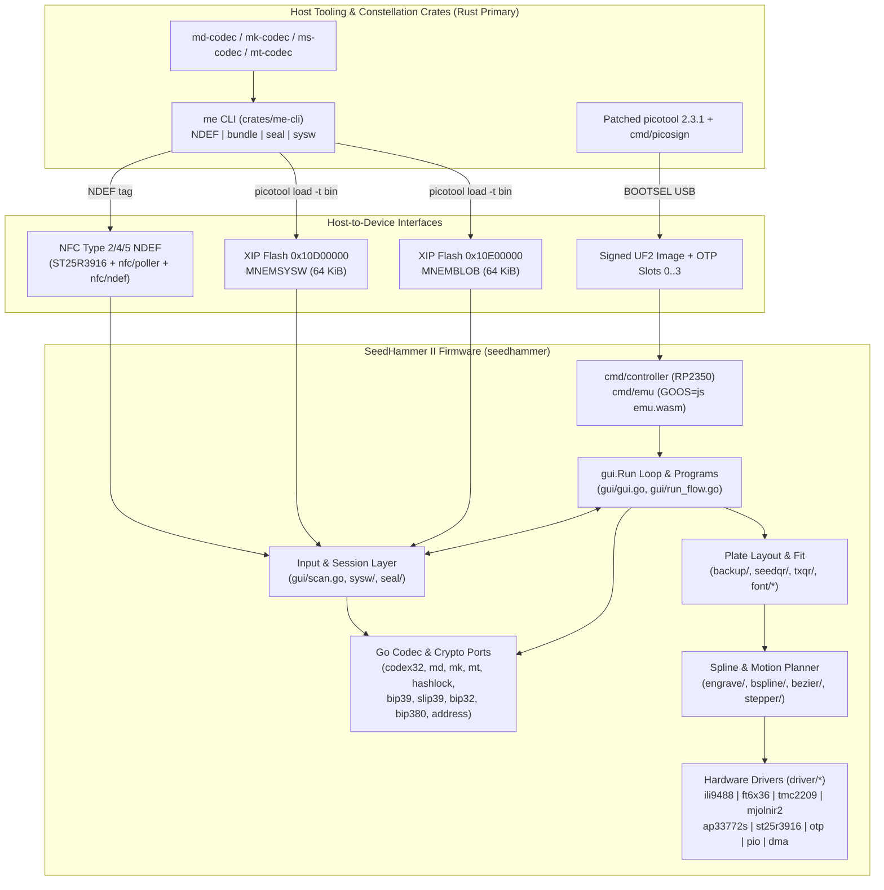

# SeedHammer II (`SH2`) Firmware Architecture Guide

**Baseline:** 2026-10-30 | **`seedhammer` (`origin/main`):** `abdcb1825ed3bde5e01ff0e4da33f76f08f604c2` (upstream `ea4b65be7137f268fc5e97e06d0fda4996233fbb`) | **`mnemonic-engrave` (`origin/master`):** `a75719996304086e5f293aaf26812ff242a25244`

---

## 1. System Overview & Ownership Boundaries

The `bg002h/seedhammer` fork targets the **SeedHammer II (`SH2`)** controller (Raspberry Pi **RP2350** dual Cortex-M33, 16 MB QSPI flash, 520 KB SRAM, 8 MB PSRAM on TinyGo target `pico-plus2`). It extends upstream SeedHammer v1.4.3 to engrave and verify standard Bitcoin backups (BIP-39, SLIP-39, SeedXOR, BIP-85, BIP-380 descriptors) and **Shibboleth constellation** artifacts:

- **`ms1`** — BIP-93 `codex32` shares and `m`-format unshared singles (threshold `'0'`, share index `'s'`, 4-char ID `'entr'` for prefixes `0x00` raw BIP-39 entropy and `0x02` language+entropy; `'hash'` for prefix `0x03` 32-byte hashlock preimages).
- **`md1`** — Binary output descriptors and wallet-policy templates (wire v4/v8) with 13-char regular BCH(93,80,8) NUMS checksums.
- **`mk1`** — Chunked BIP-32 account extended public key (`xpub`) cards with origin metadata and policy/template ID stubs.
- **`mt1` / `tx:`** — Chunked `mt1` or raw transaction QR (`txqr` Structured Append) backups for steel archival.
- **Flash containers** — Systemwide Payload (`MNEMSYSW` at XIP `0x10D00000`) and Encrypted Payload Delivery (`MNEMBLOB` at XIP `0x10E00000`).

### Repository & Normative Authority Boundaries

| Layer | Owning Repository | Role & Authority |
|---|---|---|
| Device firmware, GUI, motion planner, RP2350 drivers, WASM emulator | `seedhammer` (`bg002h/seedhammer`) | Authoritative for device execution, plate layout (`backup/`, `engrave/`), and RP2350 control (`cmd/controller/`, `driver/*`). |
| Firmware specs, host `me` CLI, `mnemonic-io-lib`, OTP/signing scripts, `me-preview` | `mnemonic-engrave` (`bg002h/mnemonic-engrave`) | Home of firmware specs (`design/SPEC_*.md`), follow-ups (`design/FOLLOWUPS.md`), primary `seal`/`sysw` modules (`crates/me-cli`), and patched `picotool` 2.3.1 (`flake.nix`). |
| Constellation wire codecs (`md1`, `mk1`, `ms1`, `mt1`, hashlock) | `descriptor-mnemonic`, `mnemonic-key`, `mnemonic-secret`, `mnemonic-transaction` | **Rust-primary rule:** Rust crates (`md-codec`, `mk-codec`, `ms-codec`, `mt-codec`) lead normative behavior; Go packages (`md/`, `mk/`, `codex32/`, `mt/`, `hashlock/`, `seal/`, `sysw/`) are downstream ports pinned by SHA-256 vectors. (Go convergence fixes check Rust first; firmware-native code has no Rust counterpart.) |
| Host bundle CLI (`mnemonic`), word-card codec (`wc-codec`), and `egui` utility GUI (`mnemonic-gui`) | `mnemonic-toolkit`, `mnemonic-gui` | `mnemonic` CLI synthesizes/restores `ms1`/`mk1`/`md1` bundles and word cards; `mnemonic-gui` (`egui`/`eframe`, binaries `mnemonic-gui` and `gui-render`) drives `mnemonic`, `md`, `ms`, and `mk`. |
| Refugium CLI (`mr`) & Slint wallet GUI (`mr-gui`) | `mnemonic-refugium` (`mr`), `refugium-wallet` (`mr-gui`) | Coordinate Refugium ceremonies/sittings and consume the `-tags refugium` firmware profile and `sysw` payloads. |

---

## 2. Entry Points, Build Targets & Build Profiles

### Entry Points (`cmd/`)

- **`cmd/controller`** (`//go:build tinygo && rp`): Production `SH2` firmware. `main()` (`cmd/controller/main.go`) calls `Init()` (`cmd/controller/platform_sh2.go:238`) and iterates `gui.Run(p, Version)`.
- **`cmd/emu`** (`//go:build js`): Browser WASM emulator (`cmd/emu/build.sh` outputs `cmd/emu/emu.wasm`) rendering `gui.Run` onto `<canvas>` with simulated NFC/flash payloads and `window.shToolpath` step-stream capture (`cmd/emu/toolpath_js.go`).
- **`cmd/picosign`**: Upstream host utility (`hash`, `sign`, `extract` in `cmd/picosign/main.go`) that hashes RP2350 `picobin` load-map + image-block data and embeds an externally produced `secp256k1` public key and signature (`-pubkey`, `-sig`, `-sigfmt raw|der`) or zeroes them (`-clear`).
- **Utilities**: `cmd/kdfbench` and `cmd/sealread` (`tinygo && rp`); `cmd/assets`, `cmd/bitmapfont`, `cmd/vectorfont`, `cmd/wordlist` (upstream `go generate`); `cmd/plateview` (`-plate <name> -o <file.svg|.png>`), `cmd/gaterecord`, `cmd/policyprobe`, `cmd/buildpayloadcards`, `cmd/buildpayloadcomposer`.

### Hardware Initialization & Automatic Startup Homing (`cmd/controller/platform_sh2.go`)

`Init()` (`cmd/controller/platform_sh2.go:238–305`) executes in strict order with **automatic physical motion when 20–28 V USB-PD is present**:
1. **Data I2C & Early NFC Init (`:239–259`):** Configures `dataI2C` (400 kHz) and runs `p.initNFC(st25r3916.New(mi2c, NFC_INT))` **first**, ensuring `-tags refugium` powers down the ST25R3916 field (`d.Close()`) even if a later step fails `Init()`.
2. **USB-PD Negotiation (`:260–267, 421–479`):** Configures `ap33772s`, sets up engraver pins (`configEngraverPins()`), and runs `monitorPowerSupply(usbpd)`. `adjustSupplyVoltage` attempts up to **3 retries** to negotiate 20–28 V (each attempt sleeping **100 ms** for contract settling before checking voltage, and sleeping **500 ms** before retrying on mismatch, or returning early on I2C error). Without 20–28 V (e.g., on a 5 V laptop USB port), `monitorPowerSupply` calls `rebootIntoBOOTSEL()` *before* LCD init.
3. **Engraver Setup & Concurrent Automatic Homing (`:268–282, 525–576`):** When `monitorPowerSupply` succeeds, `Init()` configures Mjolnir2/TMC2209 steppers (`configEngraver(voltage)`) and **spawns `go home()` (`:274–281`) before initializing the LCD or touch controller**. `home()` acquires `p.Engraver(true)` and calls `e.Close()`, running `d.home()` (`cmd/controller/engraver.go:186–216`): driving X/Y axes toward the homing endstops (`-homingDist`) at `homingSpeed = 15 * mm` and moving the needle to plate origin (`originX = 5.0 * mm`, `originY = 3.2 * mm`) concurrently with display startup and without a GUI prompt.
4. **Secure-Boot Probe, LCD & Touch (`:284–305`):** Allocates the 6-strip RGB565 framebuffer, checks `isSecureBootEnabled()` (`gui.FeatureSecureBoot`), configures the 480×320 `ili9488` LCD over PIO0 + DMA, and configures `touchI2C` (`ft6x36`).

### Compile-Time Build Tags & Profiles

| Build Tag / Target | Controlling Files | Behavior Delta |
|---|---|---|
| `tinygo && rp` (`-target pico-plus2`) | `cmd/controller/*.go`, `driver/*/*_rp2*.go`, `seal/read_tinygo.go`, `sysw/read_tinygo.go` | Builds for RP2350 (`-stack-size 16kb -gc precise -opt 2 -scheduler tasks`). Enables XIP readers at `0x10D00000` (`sysw.RegionAddr`) and `0x10E00000` (`seal.PayloadAddr`) and bootrom `otp_access` (`driver/otp/otp_rp2350.go`). |
| `refugium` (`-tags refugium`) | `gui/profile_refugium.go`, `cmd/controller/nfc_refugium.go`, `cmd/controller/lockboot_refugium.go`, `gui/debugcmd_refugium.go`, `gui/prooftriggers_refugium.go`, `gui/passphrase_off.go` | **Refugium profile:** (1) `initNFC` calls `d.Close()` on ST25R3916 at boot (`regOpCtrl 0x02 = 0x00`); failure halts on `nfcFaultScreen`. (2) Compiles out `LockBoot`, `FOREVERLAURA!`, and QA triggers (`TEXTPROOF!`, `CONSTPROOF!`, `BOTHPROOF!`, `SIZEPROOF!FRONT`, `SIZEPROOF!BACK`, `PASSPROOF!`). (3) Disables BIP-39/SLIP-39 passphrases (`passphraseOffNotice`, `slip39PassphraseRefusal`, hides `BIP-39 Password`, refuses `sysw` `pass:`). (4) Suppresses `ms1` string QRs (`gui/ms1_qr_gate.go`: `noMS1QR`, `noFreeTextQR`) while cutting Standard SeedQRs on `ms1` word plates (`backup.EngraveSeedStringSeedQR`). Gates: `scripts/refugium-elf-check.sh`, `scripts/refugium-tagged-test.sh`. |
| `debug` (`-tags debug`) | `cmd/controller/debug_sh2.go`, `gui/debug.go` | Enables UART/USB-CDC keyboard navigation (`w/a/s/d/enter/b`), `s` screenshot dump, and frame timing logs. |
| `js` (`GOOS=js GOARCH=wasm`) | `cmd/emu/*.go` | Compiles `gui` into `cmd/emu/emu.wasm` (`cmd/emu/build.sh:13`) with canvas/touch bindings and embedded demo payloads. |
| `oraclelive` (`-tags oraclelive`) | `oracle/live_test.go`, `sysw/vendored_vectors_live_test.go`, `gui/chain_fixture_live_test.go`, `gui/multisig_build_oracle_live_test.go`, `cmd/emu/sysw_composer_payload_live_test.go` | Host test tag invoking live Rust binaries (`md`, `mk`, `ms` in `oracle/pins.json`, plus `me`). |

---

## 3. GUI Architecture, Event Model & Programs

### Coroutine Frame Loop (`gui/gui.go`, `gui/event.go`, `gui/op/op.go`)

`gui.Run(platform, version)` returns an `iter.Seq[struct{}]`. A `Context` holds an immediate-mode display-list buffer (`ctx.B` of type `op.Buffer`), an event queue, `sysw` session state (`ctx.sysw`), and an idle-wipe guard (`ctx.wipe`). Screens call `ctx.Frame()`, yielding to `cmd/controller/main.go` to drain `Platform.Events` and dirty-rect the 480×320 framebuffer via `lcd.Draw`.

- **Touch-only hardware:** Physical `SH2` units have **no directional buttons**; input comes from `ft6x36` (`PointerEvent` routed by `Clickable` hit areas via `op.Input`). `Warning.Layout` (`gui/gui.go:465`) binds touchable `arrowUp`/`arrowDown` `Clickable`s, while `fadeClip` (`gui/gui.go:995`) remains a no-op stub coupled to `scrollArrowDownVisible`.
- **Navigation:** `Button1` (top-left) is Back/Cancel; `Button3` (bottom-right) is Confirm/Next/Page; `ConfirmWarningScreen` requires press-and-hold.

### Top-Level Programs (`gui/gui.go` `program` enum)

`StartScreen` presents up to 12 navigable programs (`gui/gui.go:175–255`, `gui/run_flow.go`; plus non-navigable `qaProgram`):
1. **`Backup Wallet`** (`backupWallet`) — Enter BIP-39 words, `ms1`/codex32, SLIP-39, or **SeedXOR** (`combineSeedXORFlow`, option 4 in `newInputFlow` via `seedxor.Combine`); verify fingerprint/addresses; engrave plate; run `plateVerifyFlow`.
2. **`Engrave Single-Sig`** (`engraveSingleSig`) — Seed → derive BIP-44/49/84/86 account → mint `ms1` + `mk1` + `md1` bundle → engrave → readback (`singleSigVerifyFlow`).
3. **`Engrave Multisig`** (`engraveMultisig`) — Build or supply an `md1` multisig policy with local seeds and/or cosigner `mk1` cards → engrave → readback (`multisigVerifyFlow`).
4. **`Wallet Policy`** (`walletPolicy`, `gui/wallet_policy.go`, `gui/composer_*.go`) — Via `composerDoorFlow`: (a) compose a Miniscript/Taproot policy (`composerFlow`: timelocks, 4 hashlock kinds, NUMS or Liana internal keys), (b) prove and engrave an external `md1`/`Descriptor` policy with derived addresses, or (c) engrave hashlock preimage plates (`composerHashlockPlatesFlow`).
5. **`Engrave Bundle`** (`engraveBundle`, `gui/bundle.go`) — Gather multi-card `md1`/`mk1` sets via NFC or `sysw`, verify cross-chunk integrity and `chunk_set_id`, and sequence engraving.
6. **`Engrave Transaction`** (`engraveTransaction`, `gui/transaction.go`) — Gather `mt1` chunks (NFC or `sysw`) or `tx:` records (`sysw`), parse via `mt.Decode` / `mt.ParseTx`, and engrave as `mt1` text (`3.0` mm) or `txqr.EncodeSet` QR plates (substituting a warning legend when unconfirmed/unsigned).
7. **`Engrave Text`** (`engraveText`, `gui/freetext_flow.go`) — Free-text and optional QR engraving with auto-fit across `backup.FontSizes` (`6.0..3.0` mm) and Title/Footer bands.
8. **`BIP-39 Password`** (`engravePassphrase`, `gui/passphrase_flow.go`) — Printable-ASCII passphrase plate (`≤ 100` chars) with visible-space glyph (`backup.SpaceMark = '\x1f'`) and optional fingerprints. Hidden under `-tags refugium`.
9. **`Account Xpub`** (`engraveXpub`, `gui/derive_xpub.go`) — Seed + optional passphrase → `deriveAccountXpub` → display and optionally engrave `mk1`.
10. **`BIP-85 Child Seed`** (`bip85Derive`, `gui/bip85.go`) — Derive a 12- or 24-word BIP-85 child seed (`bip85.DeriveBIP39`) and route to `engraveSeed`.
11. **`Load Payload`** (`loadPayload`, `gui/sysw_load.go`) — Load or unload `MNEMSYSW` at `0x10D00000` into `ctx.sysw`.
12. **`Sealed Payload`** (`unlockPayload`, `gui/unlock_flow.go`) — Shown when `Platform.PayloadReader().Probe()` detects `MNEMBLOB` at `0x10E00000`.

---

## 4. Representative Code Journeys

### Journey A: Public Backup Input (`Wallet Policy`) to Verification & Engraving

1. **Source Selection (`gui/wallet_policy.go:walletPolicyFlow`):** Runs `composerDoorFlow` (`gui/composer_door.go`). External policies offer `syswOfferCards(ctx, th, sysw.ClassMDMK, ...)` or `syswOfferAlt(..., sysw.ClassDescriptor, ...)` (`gui/sysw_source.go`), or fall back to NFC (`bundleGatherFlowResume` in `gui/bundle_flow.go`).
2. **Acquisition & Validation (`nfc/poller` → `nfc/ndef` → `gui/scan.go:scanner.Scan` → `gui/bundle.go:bundleGatherer.offer`):**
   - `nfc/poller/poller.go` wraps tag reads in `ndef.NewMessageReader` and `ndef.NewRecordReader` (`nfc/ndef/ndef.go`), decoding Well-Known `'T'` (UTF-8 text) and `'U'` (URI with expanded prefix) records before `scanner.Scan` reads up to `8,191` decoded bytes (`make([]byte, 8*1024)` overflows at `8,192`).
   - `gui/bundle.go:classify` admits `mdmkText` (`codex32.ValidMD` 13-char regular BCH max 96 chars; `codex32.ValidMK` chunked regular or 15-char long BCH), refuses `codex32.String` (`clsMs1Refuse`) and unchunked `mk1` (`clsSingleMK1Refuse`), and drops other scan objects.
   - `md1Gatherer.offer` (`gui/md1_gather.go`) and `mk1Gatherer` (`gui/mk1_inspect.go`) group chunks by `ChunkSetID` and run `md.Reassemble` / `md.Decode` or `mk.Decode`. Disagreements with `mk.DerivedChunkSetID` trigger `showBundleCSIDMismatchNotices` (` [csid <declared>!<derived>]`).
3. **Address Proof & Consent (`gui/wallet_policy.go:walletPolicyConsentLines`):**
   - Calls `md.ExpandWalletPolicyChunks(md1)` (seating keyless templates via `seatKeyCards` in `gui/key_card_seating.go`), computes `md.FormAwareIdChunks(md1)` (`WalletPolicyId` or `WalletDescriptorTemplateId`), derives receive addresses `0..2` (`md/script_emit.go`, `address.Format`), and presents `confirmReviewScreen`.
4. **Engraving & Cancellation (`gui/bundle_flow.go:bundleEngrave` → `gui/engraver.go:engraveFlow`):**
   - Builds layout via `validateMdmk` (`gui/bundle.go`) and `backup.EngraveText` (`backup/backup.go`), plans splines via `engrave.PlanEngraving` (`engrave/engrave.go`), and cuts via `engraveFlow`.
   - **Failure/Cancellation:** Malformed chunks return `gatherIgnored`; `ms1` secrets or unchunked `mk1` cards over NFC are refused. Back from review returns to `bundleGatherFlowResume` with `gathered` preserved. Back mid-cut pauses motion; hold-to-confirm re-homes (`Engraver.Move`) and fast-forwards the `Engraving` iterator to `completed` steps before resuming.

### Journey B: On-Device Secret Entry (`Backup Wallet`) to Engraving & Post-Cut Verification

1. **Acquisition (`gui/gui.go:backupWalletFlow` → `newInputFlow` / `seedEntryFlow`):**
   - Offers `sysw` (`ClassMnemonic` or `ClassCodex32Secret`, gated by `syswSourceAccept` in `gui/sysw_source.go`) or keyboard entry (`inputWordsFlow`, `inputCodex32Flow`, `inputSLIP39Flow`).
   - `codex32/correct.go` repairs up to 1 substitution or 1 erasure (`?`). Unshared `m`-format secrets (`codex32.DecodeMS1` in `codex32/mspayload.go`) offer `ms1BackupRouteChoice` (`gui/ms1_decode.go`).
2. **Confirmation & Fingerprint (`gui/gui.go:backupWalletFlow` → `engraveSeed`):**
   - Confirms words via `ss.Confirm(ctx, th, mnemonic)` on `SeedScreen`, runs `askBIP39Passphrase` + `passphraseFlow` (skipped under `-tags refugium`), derives and zeroes the master key (`deriveMasterKey` at `gui/gui.go:333` → `bip32.MasterKey` → `mk.Zero()`), and confirms the fingerprint.
3. **Layout & Engraving (`gui/gui.go:engraveSeed` / `engraveCodex32`):**
   - Word plates use `backup.EngraveSeed` (`backup/backup.go:130`) with `seedqr.CompactQR`.
   - `ms1` plates use `backup.EngraveSeedString` (ECC-M QR, `qrc.Size <= 33`, max 90 chars) by default. Under `-tags refugium`, `ms1` string QRs are suppressed (`gui/ms1_qr_gate.go`), while word-backed `ms1` plates use `backup.EngraveSeedStringSeedQR` (`seedqr.QR`).
   - `engraveFlow` streams knots through `stepper.Driver.Knot` (`stepper/stepper.go`) into 5-bit PIO words at `engravingSpeed = 4 * mm` (`cmd/controller/platform_sh2.go:223`).
4. **Post-Cut Verification (`gui/plate_verify.go:plateVerifyFlow`):**
   - Offers `every word`, `even words`, `odd words`, `6 words`, `3 words`, `read only`, or `skip`. Subset positions are drawn via CSPRNG rejection sampling (`drawPositions`) per attempt (`checksumGate: false`), ending on `verifyProvenanceLine` (`gui/verify_status.go`).

### Journey C: Flash Payloads (`sysw` at `0x10D00000` & `seal` at `0x10E00000`)

1. **Systemwide Payload (`sysw`, `MNEMSYSW`, `gui/sysw_load.go:syswLoadFlow`):**
   - `sysw.XIPReader` (`sysw/read_tinygo.go`) reads `0x10D00000` (`RegionLen = 65536`, `MaxSectionLen = 32734`); `sysw.ParseHeader` (`sysw/header.go`) bound-checks the 52-byte Big-Endian header (`TotalLen = 52 + pub_len + ct_len + 16` when sealed) before KDF.
   - If `h.Sealed()` (`h.CtLen > 0`), collects 1–24 words (`terminator: true`, `checksumGate: false`), confirms word count, derives the AES-256-GCM key via `seal.DeriveKey` (`seal/pbkdf2.go`, `100,000..2,000,000` iterations), and opens `ct_len` ciphertext bytes + 16-byte GCM tag over `AAD = header || public_section` (`sysw.Open` in `sysw/open.go`), establishing `[compared]`.
   - If `pub_len > 0`, displays `sysw.FormatHash(p.PublicHash)` (`sysw/pubhash.go`; confirming establishes `[compared]` when unsealed).
   - Populates `ctx.sysw` (`gui/sysw_session.go:load`), validating LF-separated records (`sysw.Classify` in `sysw/classify.go`) and computing `[mdmk-decode]` / `[mt-decode]`. Lives for the process lifetime without an idle timer.
2. **Encrypted Sealed Payload (`seal`, `MNEMBLOB`, `gui/unlock_flow.go:unlockPayloadFlow`):**
   - `seal.XIPReader` (`seal/read_tinygo.go`) reads `0x10E00000` (`MaxSectionLen = 8191`, `MaxRecords = 24`, `MaxRecordLen = 512`).
   - `Opener.Inspect` (`seal/open.go`) validates the public section (`ClassMDMK` only, lowercase, decodable via `decodePublicSet`) and computes `seal.PublicDataHash`.
   - If `Sealed()`, `unlockSealedFlow` (`gui/unlock_kdf.go`) arms `wipeGuard` (`gui/wipe_guard.go`), collects 12 checksum-valid words (`unlockPassphraseFlow`), disarms the guard before KDF, converts words via `passphraseBytes`, and runs `unlockDerive` (`kdfStepIterations = 500`, ~51 ms/frame).
   - `Opener.UnlockWithKey` decrypts the secret section (`ClassMDMK`, `ClassCodex32Secret <= 90` chars, or `ClassMnemonic` 12/15/18/21/24 words) and zeroes the XIP copy (`clear(blob); blob = nil`).
   - `unlockSecretSession` (`gui/unlock_session.go`) arms `wipeGuard` (`3:00` idle → `0:30` warning → zero records, `ctx.B.Scrub()`, unwind to `StartScreen`) and zeroes each secret record via `p.WipeSecretAt(i)` when its plate is built.

---

## 5. Secret-Data Lifetime, Scrubbing & Documented Limitations

| Secret Artifact | Scrubbing Mechanism & Seam | Documented Residual Limitation |
|---|---|---|
| BIP-39 64-byte seed & `hdkeychain.ExtendedKey` | `defer clear(seed)` / `wipeBytes(seed)` and `mk.Zero()` in `deriveMasterKey` (`gui/gui.go:333`), `deriveAccountXpub` (`gui/derive.go:20`), and `bip32.MnemonicFingerprint` (`bip32/master.go`). Verified by `deriveSeedHook` / `deriveMasterKeyHook`. | `hdkeychain.Neuter()` aliases `chainCode`/`parentFP`; serialize `acct.String()` *before* `k.Zero()` (`gui/derive.go:46`). |
| `seal` buffers, passphrases & KDF state | `AdmittedRecord.Record` (`[]byte`) wiped per plate (`WipeSecretAt`) and on exit (`defer p.Wipe()`). Passphrases use `passphraseBytes` (`[]byte`) and `Deriver.Wipe()`. Verified by `unlockPassphraseWordsHook` / `unlockKeyHook`. | `seal.Classify` converts `ms1` records to `string` for `codex32.New` (`seal/record.go:276`), living until GC (`F-88`). |
| Display list & active cut splines | `ctx.B.Scrub()` zeroes `op.Buffer` backing arrays on `unlockPassphraseFlow`, `unlockSecretSession`, and `wipeGuard` exit. | During an active ~21-minute cut, secrets remain in `plate.Spline` / `engrave.Engraving` closures (`F-83`). |
| Go `string` values & TinyGo GC (`-gc precise`) | Mutable `[]byte` and `bip39.Mnemonic` (`[]Word`) buffers are cleared (`clear(...)`). | **Architectural limitation:** Go `string` values (`codex32.String`, `sysw.Payload` records, `SeedString.Seed`, `seedqr` digits) are immutable and unzeroable; TinyGo's GC does not scrub freed blocks. Hard boundary is power-off (bootrom clears main SRAM `0x20000000..0x20082000` on next signed boot via `picotool seal --clear`). |

---

## 6. Validation Tiers: What Each Tier Can and Cannot Establish

| Validation Tier | Command / Tool | Establishes | Cannot Establish |
|---|---|---|---|
| **Host Go unit & golden tests** | `go test ./...` and `/scratch/code/shibboleth/mnemonic-engrave/scripts/gui-shard-test.sh ./gui/ 24` | Functional logic, Rust-vector byte parity, `.bin` spline goldens, scrubbing hooks, UI flows. | 32-bit `int` wrap bugs, TinyGo codegen/GC, RP2350 register/PIO timing, physical legibility. |
| **32-bit width gate** | `scripts/test-32bit.sh` (`GOARCH=386 go test ...`) | Catches `int(uint32)` sign-extension and 32-bit slice-bound overflows matching Cortex-M33. | Target TinyGo codegen or inline `cgo` bootrom calls. |
| **Live Rust oracle differential** | `scripts/oracle-live.sh` (`-tags oraclelive`) | Agreement with attested Rust CLI binaries (`md`, `mk`, `ms` in `oracle/pins.json`, plus `me`). | Behavior of unpinned commits when `oracle/pins.json` lags repo HEADs. |
| **TinyGo compile & ELF check** | `nix run .#build-firmware` + `scripts/refugium-elf-check.sh` | `tinygo && rp` buildability, flash/SRAM size, load-map `Clear 0x20000000->0x20082000`, absence of forbidden symbols (`LockBoot`, `passphraseFlow`) under `-tags refugium`. | Cortex-M33 runtime execution, DMA/PIO interrupts, XIP dereference semantics. |
| **Browser WASM emulator** | `./cmd/emu/build.sh` (`cmd/emu/emu.wasm`) + `scripts/emu-refugium-walk.sh` | Pixel-accurate 480×320 rendering, touch hit-testing, `window.shToolpath` pause/resume equivalence. | Stepper acoustics/missed steps, needle depth, USB-PD power gating. |
| **Physical Pico 2 & SH2 bench** | `scripts/pico2-bootkey-rehearsal.sh`, `scripts/refugium-otp.sh`, real cuts | Bootrom signature check, SRAM clear load-map execution, OTP fuses, ST25R3916 RF off, steel QR scanability. | Automated CI regression (requires hardware in the loop). |

---

## 7. Practical Guide: Locating Code & Assessing Change Impact

- **Constellation codecs or payload classification:** Normative changes must land in the Rust primary first (`descriptor-mnemonic`, `mnemonic-key`, `mnemonic-secret`, `mnemonic-transaction`, or `mnemonic-engrave/crates/me-cli/src/{seal,sysw}`), regenerate vectors, and then update the Go port (`md/`, `mk/`, `codex32/`, `mt/`, `hashlock/`, `seal/`, `sysw/`) and `*.provenance.json`. Go-only convergence fixes are permitted after verifying the Rust primary does not share the bug (`mnemonic-engrave/CLAUDE.md:28`). See [HOST_INTERFACES.md](HOST_INTERFACES.md) and [SOURCE_MAP.md](SOURCE_MAP.md).
- **Plate geometry, fonts, or engraving speed:** Inspect `backup/` and `engrave/engrave.go`. Spatial calibration is fixed at `6,400` microsteps/mm (`mm = 200 / 8 * 256`); lowering `engravingSpeed` from `8 * mm` (retained in test-local copies so goldens do not move) to `4 * mm` (`cmd/controller/platform_sh2.go:223` and `internal/sh2/params.go`) halves needle dot spacing (`0.20` mm → `0.10` mm against the 25 ms solenoid period) and lengthens the sampled timing-word stream.
- **GUI flows or screens:** Inspect `gui/gui.go` and feature flows (`gui/wallet_policy.go`, `gui/composer_*.go`, `gui/sysw_*.go`, `gui/unlock_*.go`, `gui/transaction.go`). Use `Clickable` for touch targets, printable ASCII (`gui/font_coverage_test.go`), `defer` scrubbing, and `-tags refugium` gates.

### Detailed Specifications & Manuals
- Runbooks: `seedhammer/docs/custom-firmware.md` ([GitHub baseline](https://github.com/bg002h/seedhammer/blob/abdcb1825ed3bde5e01ff0e4da33f76f08f604c2/docs/custom-firmware.md)), [FIRMWARE-QUICKSTART.txt](../../FIRMWARE-QUICKSTART.txt), [PICOTOOL_PIN.md](../PICOTOOL_PIN.md)
- Specs: [SPEC_encrypted_payload_delivery.md](../SPEC_encrypted_payload_delivery.md), [SPEC_systemwide_payloads.md](../SPEC_systemwide_payloads.md), [SPEC_sh2_sysw_consumption.md](../SPEC_sh2_sysw_consumption.md), [SPEC_wallet_policy_composer.md](../SPEC_wallet_policy_composer.md), [SPEC_engrave_transaction.md](../SPEC_engrave_transaction.md)
- Companion docs: [SOURCE_MAP.md](SOURCE_MAP.md), [HOST_INTERFACES.md](HOST_INTERFACES.md), [OPEN_QUESTIONS.md](OPEN_QUESTIONS.md), [FOLLOWUPS.md](../FOLLOWUPS.md)
